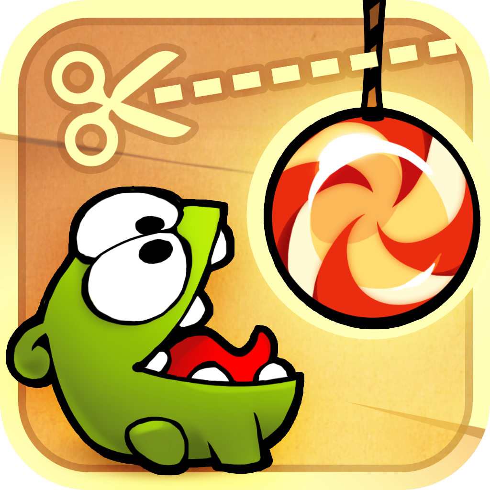
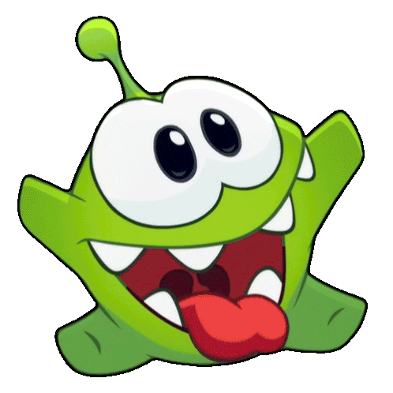

# Cut the Rope (2010) – Modern p5.js & Matter.js Remake

<div align="center">
  <table border="0" style="border: none; border-collapse: collapse;">
    <tr>
      <td align="center" style="border: none; padding: 10px;">
        
      </td>
      <td align="center" style="border: none; padding: 10px;">
        
      </td>
    </tr>
  </table>
  <p><sub><em>Cut the Rope (2010) classic promotional artwork alongside animated celebratory Om Nom. Sourced and adapted for educational and academic showcase purposes.</em></sub></p>
</div>

A modular physics puzzle remake inspired by the worldwide mobile classic **Cut the Rope** (2010), developed in JavaScript using the [p5.js](https://p5js.org/) creative coding library and the [Matter.js](https://brm.io/matter-js/) 2D physics engine.

> 📌 **Note:** As a custom academic interpretation, this project is inspired by the original physics puzzle game and deliberately adapts certain mechanics, visual assets, and audio choices rather than attempting a 1:1 proprietary binary clone.

---

## 🕹️ Overview & Gameplay

### What is Cut the Rope?
Originally released in 2010, **Cut the Rope** is a seminal physics-based puzzle video game. Players are tasked with feeding delicious candy to a small, lovable green creature named **Om Nom**. The candy is suspended by one or more elastic ropes, swings across obstacles, collects up to three golden stars, and interacts with environmental gadgets (bubbles, air cushions, gravity triggers, and spikes).

The player slices the ropes by swiping across the screen with a blade gesture, timing the cuts to use gravitational acceleration and momentum to guide the treat safely into Om Nom's waiting mouth.

### Key Highlights of This Remake
- **Matter.js Rigid Body & Constraint Physics:** Real-time Verlet-like multi-node rope simulation with dynamic tension, stiffness, and pendulum momentum.
- **Slice Mechanic (Raycast / Segment Intersection):** Real-time swipe cutting that detects collisions between the player's swipe path and active rope constraint segments.
- **Custom Interactive Pointer & Trail:** Wii/Nintendo-style white glove cursor accompanied by dynamic blade ribbon slashes and particle cut sparks.
- **Robust Lifecycle State Machine:** Seamless state flow across `LOADING`, `MENU`, `PLAYING`, `LEVEL_WON`, and `LEVEL_LOST`.
- **Nostalgic Cardboard Aesthetic:** Faithful reproduction of the classic cardboard box world, Apptivity Om Nom loader, hanging pendulum swirl candy, and hanging wooden signboard.
- **100% Offline & `file:///` Compatibility:** Engineered with an in-memory Base64 asset fallback layer ([UIAssetData.js](src/ui/UIAssetData.js)) and native HTML5 media elements, allowing the game to run seamlessly from local file directories without requiring a web server or triggering CORS blocks.

---

## 🎮 How to Play

### Controls
| Input / Action | Interaction | Description |
| :---: | :---: | :--- |
| **Mouse Click & Drag** / **Touch Swipe** | ✂️ **Rope Slicing** | Swipe across any rope to cut it with a blade slash trail and sparkle burst |
| **Left Click** / **Tap** | 👆 **Interact / Pop** | Click the Start button, pop floating bubbles, or activate air cushions |
| **Mouse Movement** | 🖐️ **Cursor Tracking** | Custom white pointer with real-time motion physics and particle ribbon |

### Core Mechanics & Physics Rules
- **The Rope Constraints:** Ropes consist of linked chains of Matter.js constraint bodies connected to static pins on the ceiling or walls. They react dynamically to the candy's weight, swinging in natural pendulum arcs.
- **The Cutting Mechanism:** When the cursor drags across the screen, line-segment intersection algorithms test the slice line against every segment of active ropes. Intersected ropes are immediately severed, releasing constraint forces.
- **The Candy Physics:** A circular rigid body with realistic mass, restitution (bounciness), and air friction. If it falls beyond the bottom boundary of the box (`height + 50px`), the level fails.
- **Om Nom (Target Zone):** Positioned on a pedestal at the bottom of the screen. Features an open-mouth sensor zone that detects candy contact, triggering happy victory eating sequences and advancing the game.
- **Star Collectibles:** Up to three golden stars are placed strategically in each level. Candy touching a star collects it, producing celebratory particle fireworks and updating the score.
- **Gimmicks & Elements:**
  - **Bubbles:** Encapsulate the candy upon contact, counteracting gravity and causing it to float upward until popped by the player.
  - **Spikes:** Hazardous obstacles that shatter the candy on contact, forcing a level restart.

---

## 👥 Team & Development Roles

The project was developed under a contract-driven modular architecture where each developer took ownership of distinct systems:

| Developer | Role | Module & Key Contributions |
| :--- | :--- | :--- |
| **Ángel** | **Core Architecture & Physics World** (*The Foundation*) | Authored [sketch.js](sketch.js) and [src/core/PhysicsWorld.js](src/core/PhysicsWorld.js). Established the Matter.js physics engine integration, 60 FPS update cycle, master gravity and boundaries, collision event dispatcher (`onCollide`), and coordinated the central orchestration lifecycle (`preload`, `setup`, `draw`, and input events). Co-authored [src/config.js](src/config.js). |
| **Farid** | **Mechanics: Ropes, Cutting & Impulses** (*The Engineer*) | Authored [src/mechanics/Rope.js](src/mechanics/Rope.js), [src/mechanics/Cutter.js](src/mechanics/Cutter.js), and [src/mechanics/Gimmicks.js](src/mechanics/Gimmicks.js). Engineered multi-segment rope constraint chains, swipe raycasting line-intersection algorithms for cutting, and environmental interactions (floating bubbles, air cushions, spikes). Co-authored [src/config.js](src/config.js). |
| **Nicolás** | **Entities & Level Progression** (*The Level Designer*) | Authored [src/entities/Candy.js](src/entities/Candy.js), [src/entities/Target.js](src/entities/Target.js), [src/entities/Collectibles.js](src/entities/Collectibles.js), and [src/entities/LevelManager.js](src/entities/LevelManager.js). Built the candy rigid body logic, Om Nom target mouth sensor, star collection tracking, level coordinate definitions, and stage loading sequences. |
| **Ariadna** | **UI, Game States, Visual Effects & Audio** (*The Artist & Coordinator*) | Authored [src/ui/GameState.js](src/ui/GameState.js), [src/ui/UIManager.js](src/ui/UIManager.js), [src/ui/AudioManager.js](src/ui/AudioManager.js), [src/ui/UIAssetData.js](src/ui/UIAssetData.js), [src/ui/CustomCursor.js](src/ui/CustomCursor.js), and [src/ui/ParticleSystem.js](src/ui/ParticleSystem.js). Designed the loading screen with Apptivity banner and striped candy progress bar, main menu with swinging candy pendulum, rope-hung wooden signboard, interactive Start button, custom white cursor with slice trail, background music manager with autoplay unlock, and offline base64 asset bundling. |

---

## 📁 Project Architecture & Class Responsibilities

### Directory Structure
```text
CutTheRope/
├── assets/
│   ├── 06.-Menu-Music-Theme.wav    # Master menu background theme music (PCM WAV)
│   ├── cursor/
│   │   ├── cursor.png              # White Wii-style pointer idle sprite
│   │   └── cursor_pressed.png      # Pointer pressed state sprite
│   ├── docs/
│   │   ├── cut_the_rope_cover.png  # High-resolution original promotional artwork
│   │   └── om_nom_clapping.gif     # Celebratory animated Om Nom GIF
│   ├── favicon/                    # Web application icons and manifest
│   ├── ui/
│   │   ├── apptivity_banner.png    # Om Nom open mouth loading banner
│   │   ├── apptivity_stars.png     # Decorative banner stars
│   │   ├── background_cardboard_clean.jpg # Clean cardboard background texture
│   │   ├── btn_default_normal.png  # 3D red pill button normal state (455x102)
│   │   ├── btn_default_pressed.png # 3D yellow pill button pressed state (455x102)
│   │   ├── candy_swirl.png         # Swirl candy sprite
│   │   ├── loaderbar_full.png      # Striped candy progress bar texture
│   │   ├── menu_bgr_opt.jpg        # Optimized cardboard menu background
│   │   ├── menu_candy_swirl.png    # 3D swirl candy with rope hole (164x163)
│   │   ├── menu_shadow.png         # Ambient drop shadow and vignette overlay
│   │   ├── omnom_idle.png          # Om Nom idle body sprite (128x133)
│   │   ├── omnom_support.png       # Wooden pedestal stand sprite
│   │   └── spinner.png             # Rotating candy wheel spinner
│   └── sprites_test_nocomplete/    # Master sprite sheet archive
├── lib/
│   ├── matter.min.js               # Matter.js 2D physics engine
│   ├── p5.min.js                   # p5.js core graphics library
│   └── p5.sound.min.js             # p5.js Web Audio library
├── src/
│   ├── config.js                   # Canvas dimensions (480x720), physics constants & CORS patch
│   ├── core/
│   │   └── PhysicsWorld.js         # Matter.js wrapper, gravity & collision dispatcher
│   ├── entities/
│   │   ├── Candy.js                # Candy entity physics & rendering
│   │   ├── Collectibles.js         # Star collectible items
│   │   ├── LevelManager.js         # Level layout configuration & stage sequencer
│   │   └── Target.js               # Om Nom mouth target zone & eating trigger
│   ├── mechanics/
│   │   ├── Cutter.js               # Touch/mouse swipe detection & rope severing
│   │   ├── Gimmicks.js             # Bubbles, air cushions & spikes
│   │   └── Rope.js                 # Multi-segment constraint chain
│   └── ui/
│       ├── AudioManager.js         # Background music, autoplay unlock & volume fade
│       ├── CustomCursor.js         # Custom white pointer, slash ribbon & sparkle burst
│       ├── GameState.js            # State machine (LOADING, MENU, PLAYING, WON, LOST)
│       ├── ParticleSystem.js       # Star collection sparkles & cut particles
│       ├── UIAssetData.js          # In-memory Base64 offline asset bundle
│       └── UIManager.js            # Loading screen, menu signboard, HUD & overlays
├── index.html                      # HTML5 entry point & canvas mount
├── sketch.js                       # Master lifecycle orchestration (preload, setup, draw)
└── style.css                       # Canvas centering & responsive styling
```

### Class Responsibilities Overview
- **[sketch.js](sketch.js):** Coordinates initialization of physics and graphics, runs the 60 FPS game loop across game states, and dispatches mouse/touch gestures to the cutter and UI.
- **[src/config.js](src/config.js):** Single source of truth for resolution (`CANVAS_WIDTH = 480`, `CANVAS_HEIGHT = 720`, 2:3 aspect ratio), gravity, collision categories, and offline `p5.loadImage` compatibility layer.
- **[src/core/PhysicsWorld.js](src/core/PhysicsWorld.js):** Wraps Matter.js `Engine`, `World`, and `Composite`. Evaluates collision pairs and routes callbacks to entity instances.
- **[src/mechanics/Rope.js](src/mechanics/Rope.js):** Manages Matter.js constraint chains linking static pins to the candy body.
- **[src/mechanics/Cutter.js](src/mechanics/Cutter.js):** Tracks blade drag trajectories, runs segment-intersection queries against ropes, and triggers cut particle feedback.
- **[src/mechanics/Gimmicks.js](src/mechanics/Gimmicks.js):** Controls environmental puzzle elements including buoyant bubbles and hazards.
- **[src/entities/Candy.js](src/entities/Candy.js):** Candy rigid body kinematics, angular momentum, and visual rendering with thread-hole alignment.
- **[src/entities/Target.js](src/entities/Target.js):** Om Nom character entity with trigger collision bounds and mouth-opening reaction.
- **[src/entities/Collectibles.js](src/entities/Collectibles.js):** Star sensors that register candy collection, play sparkle animations, and increment score counters.
- **[src/entities/LevelManager.js](src/entities/LevelManager.js):** Spawns entities, anchors ropes, and transitions stages upon level completion.
- **[src/ui/GameState.js](src/ui/GameState.js):** Manages lifecycles with observer pattern notifications (`addListener`).
- **[src/ui/UIManager.js](src/ui/UIManager.js):** Renders the animated Apptivity loading screen, the main menu with rope-hung signboard, swinging candy pendulum, breathing Om Nom pedestal, interactive Start button, and HUD.
- **[src/ui/AudioManager.js](src/ui/AudioManager.js):** Audio controller managing the menu theme music, looping, browser autoplay unlock, tab visibility transitions, and smooth fade-outs.
- **[src/ui/UIAssetData.js](src/ui/UIAssetData.js):** Encodes all critical interface sprites into Base64 data URIs to guarantee offline rendering without server requirements.
- **[src/ui/CustomCursor.js](src/ui/CustomCursor.js):** Interactive custom pointer featuring motion physics, velocity tilt, decaying ribbon slash trail, and sparkle emitters.
- **[src/ui/ParticleSystem.js](src/ui/ParticleSystem.js):** Autonomous 2D particle simulation for confetti, cut sparks, and star collection bursts.

---

## 🎨 Sprites, Artwork & Visual Assets

### Visual Asset Sources & Attribution
All visual assets were obtained from community preservation archives and curated specifically for this project:

- **Custom Pointer & Slice Effects:**
  Sourced from [The Spriters Resource – Cut the Rope (PC / Computer)](https://www.spriters-resource.com/pc_computer/cuttherope/). Used to extract the clean white pointer glove and configure the dynamic slice trail.
- **UI & Gameplay Components:**
  Sourced from [The Spriters Resource – Cut the Rope (Mobile)](https://www.spriters-resource.com/mobile/cutrope/asset/51423/). The archive provided the original master sprite sheets, from which only the necessary elements were extracted and preserved:
  - `btn_default_normal.png` & `btn_default_pressed.png`: Extracted from `menu_button_default_hd.png` at exact bounding coordinates `(4, 5, 459, 107)` and `(4, 116, 459, 218)` (455×102 px).
  - `menu_candy_swirl.png`: Extracted from `menu_logo_hd.png` with top rope attachment hole intact (164×163 px).
  - `omnom_idle.png` & `omnom_support.png`: Extracted cleanly from `char_animations_hd.png` and `char_support_01_hd.png`.
  - `apptivity_banner.png`: Cropped from `apptivity_image.png` featuring Om Nom with open mouth and falling candies.
  - `loaderbar_full.png` & `spinner.png`: Candy-striped progress bar and rotating wheel.
- **Promotional Illustrations & Showcase:**
  - `assets/docs/cut_the_rope_cover.png`: Original Cut the Rope cover illustration showcasing Om Nom, candy, and scissors.
  - `assets/docs/om_nom_clapping.gif`: Celebratory animation of Om Nom clapping.

### Vector-Engineered Title Signboard
To prevent raster jaggedness and eliminate square background artifacts, the `"CUT THE ROPE"` title banner in the main menu is engineered directly as a vector Canvas element:
- Dual-line typography: `"CUT THE"` in warm cream with dark outline and `"ROPE"` in vibrant candy green with 3D drop shadow and top specular highlights.
- Beveled wooden board with brass corner rivets, suspended by two realistic ropes anchored to the ceiling.
- Vertically centered typography with balanced margins (~18 px top, ~17 px bottom) and safe clearance from the swinging pendulum candy.

### Intellectual Property & Trademark Protection
In strict adherence to intellectual property standards and educational use guidelines:
- All proprietary studio names, distributor brandings, and logos (*ZeptoLab*, *Chillingo*) were completely removed from all visual banners and interface components.
- The project is presented strictly as a non-commercial academic programming showcase.

---

## 🔊 Sound Design & Audio Adaptation

### Audio Sources & Attribution
- **Menu Theme Track:**
  Sourced from [Khinsider – Cut the Rope Arcade Gamerip (2016)](https://downloads.khinsider.com/game-soundtracks/album/cut-the-rope-arcade-gamerip-2016).
  - File: [`assets/06.-Menu-Music-Theme.wav`](assets/06.-Menu-Music-Theme.wav)
  - Format: Uncompressed 16-bit PCM WAV, 22,050 Hz Mono, 60.01 seconds seamless loop.

### Technical Audio Pipeline & Autoplay Compliance
Modern web browsers enforce strict security restrictions regarding audio playback:
1. **Autoplay Policy Unlock:**
   Browsers prevent audio playback before user interaction. [AudioManager.js](src/ui/AudioManager.js) establishes a passive interaction listener (`pointerdown`, `click`, `keydown`, `touchstart`) that immediately unlocks and triggers audio upon the player's first interaction.
2. **Smooth Audio Fade-Out:**
   When the player clicks "Start", the music does not cut abruptly. Instead, `fadeOutMenuMusic(500)` performs a linear volume attenuation over 500 ms before pausing.
3. **Page Visibility Synchronization:**
   An event listener on `visibilitychange` automatically pauses playback when the user switches browser tabs and resumes playback when returning.

---

## 📚 References & Research

- **Visual Sprites (PC):** [The Spriters Resource – Cut the Rope (PC)](https://www.spriters-resource.com/pc_computer/cuttherope/)
- **Visual Sprites (Mobile Assets #51423):** [The Spriters Resource – Cut the Rope (Mobile)](https://www.spriters-resource.com/mobile/cutrope/asset/51423/)
- **Original Soundtrack Archive:** [Khinsider – Cut the Rope Arcade Gamerip (2016)](https://downloads.khinsider.com/game-soundtracks/album/cut-the-rope-arcade-gamerip-2016)
- **Physics Engine Documentation:** [Matter.js Official Documentation & Constraint Guides](https://brm.io/matter-js/docs/)
- **Graphics Engine Documentation:** [p5.js Official Reference](https://p5js.org/reference/)

---

## 🛠️ Technical Debt & Known Scope Limitations

The following items represent design compromises or features scheduled for subsequent development phases:
- **Spiders & Additional Enemies:** Spiders climbing up ropes to steal the candy were deferred to a future milestone.
- **Complex Multi-Candy Joints:** Dual-candy mechanics (connecting two treats simultaneously with elastic bands) were simplified to single-candy physics for this sprint.
- **Level Selection World Map:** The game currently transitions directly from the Main Menu into Level 1, with stage sequencing handled programmatically by [LevelManager.js](src/entities/LevelManager.js) rather than through a card-pack selection screen.

---

## 🚀 Running the Project Locally

Thanks to the offline architecture implemented in [`src/ui/UIAssetData.js`](src/ui/UIAssetData.js) and the native HTML5 audio pipeline, **this project can be executed either directly as a local file or through an HTTP server**:

### Option 1: Direct File Execution (Zero Server Required)
Simply double-click [`index.html`](index.html) or open it directly in any modern browser:
```text
file:///path/to/CutTheRope/index.html
```

### Option 2: Local HTTP Server (Recommended for Development)
If you prefer running through a local development server:
- **VS Code:** Right-click [`index.html`](index.html) and select **"Open with Live Server"**.
- **Python:**
  ```bash
  python3 -m http.server 8000
  ```
  Open `http://localhost:8000` in your web browser.
- **Node.js:**
  ```bash
  npx serve .
  ```

---

## 🤖 Artificial Intelligence Disclosure & Acknowledgments

Artificial Intelligence tools (**Google Antigravity / Gemini**) were utilized as pair-programming assistants throughout the development of this project. AI assistance was utilized for:
- **Architecture & System Contracts:** Defining clean modular boundaries between physics simulation ([PhysicsWorld.js](src/core/PhysicsWorld.js)), UI rendering ([UIManager.js](src/ui/UIManager.js)), and state transitions ([GameState.js](src/ui/GameState.js)).
- **Coordinate Analysis & Sprite Slicing:** Calculating exact bounding boxes and resolving aspect ratio distortions on button and candy sprites.
- **Browser Compatibility Engineering:** Diagnosing Chromium CORS constraints on local `file:///` protocols and engineering the in-memory Base64 fallback system ([UIAssetData.js](src/ui/UIAssetData.js)) and HTML5 audio unlockers.
- **Documentation & Structuring:** Drafting and formatting this comprehensive `README.md`.