# Cut the Rope (2010) – Modern p5.js & Matter.js Remake

<div align="center">
  <table border="0" style="border: none; border-collapse: collapse;">
    <tr>
      <td align="center" style="border: none; padding: 10px;" valign="middle">
        
      </td>
      <td align="center" style="border: none; padding: 10px;" valign="middle">
        
      </td>
      <td align="center" style="border: none; padding: 10px;" valign="middle">
        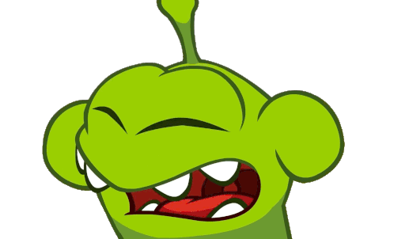
      </td>
    </tr>
  </table>
  <p><sub><em>Cut the Rope (2010) classic promotional artwork flanked by celebratory and pondering animations of Om Nom. Sourced and adapted for educational and academic showcase purposes.</em></sub></p>
</div>

A modular physics puzzle remake inspired by the worldwide mobile classic **Cut the Rope** (2010), developed in JavaScript using the [p5.js](https://p5js.org/) creative coding library and the [Matter.js](https://brm.io/matter-js/) 2D physics engine.

> 📌 **Note:** As a custom academic interpretation, this project is inspired by the original physics puzzle game and deliberately adapts certain mechanics, visual assets, and audio choices rather than attempting a 1:1 proprietary binary clone.

---

## 🕹️ Overview & Gameplay

### What is Cut the Rope?


Originally released in 2010, **Cut the Rope** is a seminal physics-based puzzle video game. Players are tasked with feeding delicious candy to a small, lovable green creature named **Om Nom**. The candy is suspended by one or more elastic ropes, swings across obstacles, collects up to three golden stars, and interacts with environmental gadgets (bubbles, air cushions, gravity triggers, and spikes).

The player slices the ropes by swiping across the screen with a blade gesture, timing the cuts to use gravitational acceleration and momentum to guide the treat safely into Om Nom's waiting mouth.

<br clear="right"/>

### Key Highlights of This Remake
- **Matter.js Rigid Body & Constraint Physics:** Real-time Verlet-like multi-node rope simulation with dynamic tension, stiffness, and pendulum momentum.
- **Slice Mechanic (Raycast / Segment Intersection):** Real-time swipe cutting that detects collisions between the player's swipe path and active rope constraint segments.
- **Custom Interactive Pointer & Trail:** Wii/Nintendo-style white glove cursor accompanied by dynamic blade ribbon slashes and particle cut sparks.
- **Robust Lifecycle State Machine:** Seamless state flow across `LOADING`, `MENU`, `PLAYING`, `LEVEL_WON`, and `LEVEL_LOST`.
- **Nostalgic Cardboard Aesthetic:** Faithful reproduction of the classic cardboard box world, Apptivity Om Nom loader, hanging pendulum swirl candy, and hanging wooden signboard.
- **100% Offline & `file:///` Compatibility:** Engineered with an in-memory Base64 asset fallback layer ([UIAssetData.js](src/ui/UIAssetData.js)) and native HTML5 media elements, allowing the game to run seamlessly from local file directories without requiring a web server or triggering CORS blocks.

---

## 🎮 How to Play

### Controls
| Input / Action | Interaction | Description |
| :---: | :---: | :--- |
| 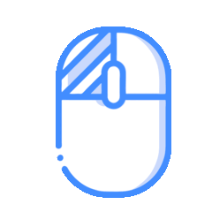<br><sub>**Left Click & Drag**</sub><br><sub><a href="https://www.flaticon.com/authors/smashicons" target="_blank" rel="noopener">Smashicons</a></sub> | ✂️ **Rope Slicing & UI Interaction** | Primary interaction: click and drag across ropes to sever them with a blade slash trail and sparkle bursts. Also used to press the Start button, pop floating bubbles, compress air cushions, and interact with victory/defeat overlays. |
| <br><sub>**Mouse Movement**</sub><br><sub><a href="https://www.flaticon.com/authors/smashicons" target="_blank" rel="noopener">Smashicons</a></sub> | 🖐️ **Cursor Tracking** | Custom white pointer with real-time motion physics, velocity-dependent angle tilt, and dynamic particle ribbon trail. |

<p align="center"><sub><em>Control icons designed by <a href="https://www.flaticon.com/authors/smashicons" target="_blank" rel="noopener">Smashicons from Flaticon</a> (Free License with Attribution). Enhanced with custom procedural animations simulating tactile clicks, velocity tilt, radial ripple waves, and blade cut motions.</em></sub></p>

### Core Mechanics & Physics Rules

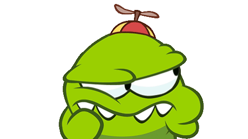

- **The Rope Constraints:** Ropes consist of linked chains of Matter.js constraint bodies connected to static pins on the ceiling or walls. They react dynamically to the candy's weight, swinging in natural pendulum arcs.
- **The Cutting Mechanism:** When the cursor drags across the screen, line-segment intersection algorithms test the slice line against every segment of active ropes. Intersected ropes are immediately severed, releasing constraint forces.
- **The Candy Physics:** A circular rigid body with realistic mass, restitution (bounciness), and air friction. If it falls beyond the bottom boundary of the box (`height + 50px`), the level fails.
- **Om Nom (Target Zone):** Positioned on a pedestal at the bottom of the screen. Features an open-mouth sensor zone that detects candy contact, triggering happy victory eating sequences and advancing the game.
- **Star Collectibles:** Up to three golden stars are placed strategically in each level. Candy touching a star collects it, producing celebratory particle fireworks and updating the score.
- **Gimmicks & Elements:**
  - **Bubbles (`Bubble`):** Encapsulate the candy upon contact, counteracting gravitational pull and causing it to float upward in buoyant levitation until clicked/popped by the player.
  - **Air Cushions (`AirCushion`):** Directional bellows that trigger an outward directional air impulse when pressed, propelling the candy along a calculated trajectory.
  - **Spikes & Hazards:** Scheduled as part of future milestones (see [Technical Debt](#-technical-debt--known-scope-limitations)).

- **Level Progression Overview:**
  - **Level 1 (Simple Pendulum):** Introduction to single-rope swinging mechanics, target feeding, and collecting 3 stars.
  - **Level 2 (Tension Triangle):** Three ropes under competing multi-angle tension requiring strategic cut sequences.
  - **Level 3 (Antigravity Bubble):** Release from rope constraint into a rising bubble to reach Om Nom.
  - **Level 4 (Cushion Propulsion):** Air cushion pulses guiding the treat horizontally into an antigravity bubble to feed Om Nom situated at the upper level.

<br clear="right"/>

---

## 👥 Team & Development Roles

The project was developed under a contract-driven modular architecture where each developer took ownership of distinct systems:

<div align="center">
  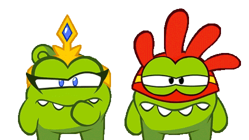
</div>

| Developer | Role | Module & Key Contributions |
| :--- | :--- | :--- |
| **Ángel** | **Core Architecture & Physics World** (*The Foundation*) | Authored [sketch.js](sketch.js) and [src/core/PhysicsWorld.js](src/core/PhysicsWorld.js). Established the Matter.js physics engine integration, 60 FPS update cycle, master gravity and boundaries, collision event dispatcher (`onCollide`), and coordinated the central orchestration lifecycle (`preload`, `setup`, `draw`, and input events). Co-authored [src/config.js](src/config.js). |
| **Farid** | **Mechanics: Ropes, Cutting & Impulses** (*The Engineer*) | Authored [src/mechanics/Rope.js](src/mechanics/Rope.js), [src/mechanics/Cutter.js](src/mechanics/Cutter.js), and [src/mechanics/Gimmicks.js](src/mechanics/Gimmicks.js). Engineered multi-segment rope constraint chains, swipe raycasting line-intersection algorithms for cutting, and environmental interactions (floating bubbles and directional air cushions). Co-authored [src/config.js](src/config.js). |
| **Nicolás** | **Entities & Level Progression** (*The Level Designer*) | Authored [src/entities/Candy.js](src/entities/Candy.js), [src/entities/Target.js](src/entities/Target.js), [src/entities/Collectibles.js](src/entities/Collectibles.js), and [src/entities/LevelManager.js](src/entities/LevelManager.js). Built the candy rigid body logic, Om Nom target mouth sensor, star collection tracking, level coordinate definitions, and stage loading sequences. |
| **Ariadna** | **UI, Game States, Visual Effects & Audio** (*The Artist & Coordinator*) | Authored [src/ui/GameState.js](src/ui/GameState.js), [src/ui/UIManager.js](src/ui/UIManager.js), [src/ui/AudioManager.js](src/ui/AudioManager.js), [src/ui/UIAssetData.js](src/ui/UIAssetData.js), [src/ui/CustomCursor.js](src/ui/CustomCursor.js), and [src/ui/ParticleSystem.js](src/ui/ParticleSystem.js). Designed the loading screen with Apptivity banner and striped candy progress bar, main menu with swinging candy pendulum, rope-hung wooden signboard, interactive Start button, custom white cursor with slice trail, background music manager with autoplay unlock, and offline base64 asset bundling. |

---

## 📁 Project Architecture & Class Responsibilities

### Directory Structure

<div align="center">
  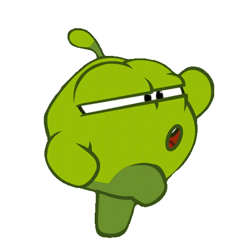
</div>

```text
CutTheRope/
├── assets/
│   ├── 06.-Menu-Music-Theme.wav    # Master menu background theme music (PCM WAV)
│   ├── cursor/
│   │   ├── cursor.png              # White Wii-style pointer idle sprite
│   │   └── cursor_pressed.png      # Pointer pressed state sprite
│   ├── docs/
│   │   ├── controls_cursor.gif      # Animated cursor motion & trail icon (Smashicons)
│   │   ├── controls_left_click.gif  # Animated left-click & slice icon (Smashicons)
│   │   ├── cut_the_rope_cover.png   # High-resolution original promotional artwork
│   │   └── ...                      # 15 Om Nom reaction and emotion GIFs (Tenor)
│   ├── entities/                   # Entity sprites and interactive audio effects
│   │   ├── candy_sprite.png        # Rotating swirl candy sprite sheet
│   │   ├── monster_chewing.wav     # Om Nom chewing audio SFX
│   │   ├── monster_open.wav        # Om Nom mouth open audio SFX
│   │   ├── monster_sad.wav         # Om Nom sad sigh audio SFX
│   │   ├── sprite.png              # Master Om Nom body sprite sheet
│   │   ├── star_1.wav..star_3.wav  # Ascending star collection chimes
│   │   ├── star_sprite.png         # Golden star rotation sprite sheet
│   │   └── support_sprite.png      # Wooden pedestal sprite
│   ├── favicon/                    # Web application icons and manifest
│   ├── fonts/
│   │   └── Fredoka/                # Fredoka rounded bold UI font family
│   ├── mechanics/                  # Mechanics sprites and audio effects
│   │   ├── bubble_attached.png     # Bubble surrounding candy sprite
│   │   ├── bubble_sheet.png        # Bubble wobble & pop sprite sheet
│   │   ├── cushion.mp3             # Air cushion / pump puff audio SFX
│   │   ├── cushion.png             # Directional air cushion bellows sprite
│   │   ├── pin.png                 # Static ceiling rope pin sprite
│   │   ├── pop.mp3                 # Bubble popping audio SFX
│   │   └── slice.mp3               # Rope slicing audio SFX
│   ├── ui/
│   │   ├── apptivity_banner.png    # Om Nom open mouth loading banner
│   │   ├── apptivity_stars.png     # Decorative banner stars
│   │   ├── background_cardboard_clean.jpg # Clean cardboard background texture
│   │   ├── btn_default_normal.png  # 3D red pill button normal state (455x102)
│   │   ├── btn_default_pressed.png # 3D yellow pill button pressed state (455x102)
│   │   ├── btn_retry.png           # Level retry icon button
│   │   ├── next_level.png          # Next level progression button
│   │   ├── menu_button.png         # Menu return button
│   │   ├── candy_swirl.png         # Swirl candy sprite
│   │   ├── loaderbar_full.png      # Striped candy progress bar texture
│   │   ├── menu_bgr_opt.jpg        # Optimized cardboard menu background
│   │   ├── menu_candy_swirl.png    # 3D swirl candy with rope hole (164x163)
│   │   ├── menu_shadow.png         # Ambient drop shadow and vignette overlay
│   │   ├── omnom_idle.png          # Om Nom idle body sprite (128x133)
│   │   ├── omnom_support.png       # Wooden pedestal stand sprite
│   │   └── spinner.png             # Rotating candy wheel spinner
│   └── sprites_test_nocomplete/    # Master sprite sheet archive
├── lib/
│   ├── matter.min.js               # Matter.js 2D physics engine
│   ├── p5.min.js                   # p5.js core graphics library
│   └── p5.sound.min.js             # p5.js Web Audio library
├── src/
│   ├── config.js                   # Canvas dimensions (480x720), physics constants & CORS patch
│   ├── core/
│   │   └── PhysicsWorld.js         # Matter.js wrapper, gravity & collision dispatcher
│   ├── entities/
│   │   ├── Candy.js                # Candy entity physics & rendering
│   │   ├── Collectibles.js         # Star collectible items
│   │   ├── EntitiesAssets.js       # Preloader and asset container for entity sprites/audio
│   │   ├── LevelManager.js         # Level layout configuration & stage sequencer (Levels 1-4)
│   │   ├── SpriteAnimation.js      # Frame-by-frame sprite sheet animator
│   │   └── Target.js               # Om Nom mouth target zone & eating trigger
│   ├── mechanics/
│   │   ├── Cutter.js               # Touch/mouse swipe detection & rope severing
│   │   ├── Gimmicks.js             # Environmental bubbles and directional air cushions
│   │   └── Rope.js                 # Multi-segment constraint chain
│   └── ui/
│       ├── AudioManager.js         # Background music, autoplay unlock & volume fade
│       ├── CustomCursor.js         # Custom white pointer, slash ribbon & sparkle burst
│       ├── GameState.js            # State machine (LOADING, MENU, PLAYING, WON, LOST, COMPLETED)
│       ├── ParticleSystem.js       # Star collection sparkles & cut particles
│       ├── UIAssetData.js          # In-memory Base64 offline asset bundle
│       └── UIManager.js            # Loading screen, menu signboard, HUD & overlays
├── index.html                      # HTML5 entry point & canvas mount
├── sketch.js                       # Master lifecycle orchestration (preload, setup, draw)
└── style.css                       # Canvas centering & responsive styling
```

### Class Responsibilities Overview

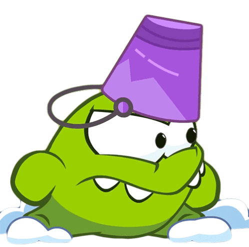

- **[sketch.js](sketch.js):** Coordinates initialization of physics and graphics, runs the 60 FPS game loop across game states, and dispatches mouse/touch gestures to the cutter and UI.
- **[src/config.js](src/config.js):** Single source of truth for resolution (`CANVAS_WIDTH = 480`, `CANVAS_HEIGHT = 720`, 2:3 aspect ratio), gravity, collision categories, and offline `p5.loadImage` compatibility layer.
- **[src/core/PhysicsWorld.js](src/core/PhysicsWorld.js):** Wraps Matter.js `Engine`, `World`, and `Composite`. Evaluates collision pairs and routes callbacks to entity instances.
- **[src/mechanics/Rope.js](src/mechanics/Rope.js):** Manages Matter.js constraint chains linking static pins to the candy body.
- **[src/mechanics/Cutter.js](src/mechanics/Cutter.js):** Tracks blade drag trajectories, runs segment-intersection queries against ropes, and triggers cut particle feedback.
- **[src/mechanics/Gimmicks.js](src/mechanics/Gimmicks.js):** Controls environmental puzzle elements including buoyant bubbles (`Bubble`) and directional air cushions (`AirCushion`).
- **[src/entities/Candy.js](src/entities/Candy.js):** Candy rigid body kinematics, angular momentum, and visual rendering with thread-hole alignment.
- **[src/entities/Target.js](src/entities/Target.js):** Om Nom character entity with trigger collision bounds and mouth-opening reaction.
- **[src/entities/Collectibles.js](src/entities/Collectibles.js):** Star sensors that register candy collection, play sparkle animations, and increment score counters.
- **[src/entities/EntitiesAssets.js](src/entities/EntitiesAssets.js):** Coordinates loading and instantiating of character animations, candy sprites, and sound effects for Om Nom and collectibles.
- **[src/entities/SpriteAnimation.js](src/entities/SpriteAnimation.js):** Generic sprite sheet animator managing frame rate, playback pacing, and looping for animated characters and stars.
- **[src/entities/LevelManager.js](src/entities/LevelManager.js):** Spawns entities, anchors ropes, and transitions stages across all four playable levels.
- **[src/ui/GameState.js](src/ui/GameState.js):** Manages lifecycles with observer pattern notifications (`addListener`).
- **[src/ui/UIManager.js](src/ui/UIManager.js):** Renders the animated Apptivity loading screen, the main menu with rope-hung signboard, swinging candy pendulum, breathing Om Nom pedestal, interactive Start button, and HUD.
- **[src/ui/AudioManager.js](src/ui/AudioManager.js):** Audio controller managing the menu theme music, looping, browser autoplay unlock, tab visibility transitions, and smooth fade-outs.
- **[src/ui/UIAssetData.js](src/ui/UIAssetData.js):** Encodes all critical interface sprites into Base64 data URIs to guarantee offline rendering without server requirements.
- **[src/ui/CustomCursor.js](src/ui/CustomCursor.js):** Interactive custom pointer featuring motion physics, velocity tilt, decaying ribbon slash trail, and sparkle emitters.
- **[src/ui/ParticleSystem.js](src/ui/ParticleSystem.js):** Autonomous 2D particle simulation for confetti, cut sparks, and star collection bursts.

<br clear="right"/>

---

## 🎨 Sprites, Artwork & Visual Assets

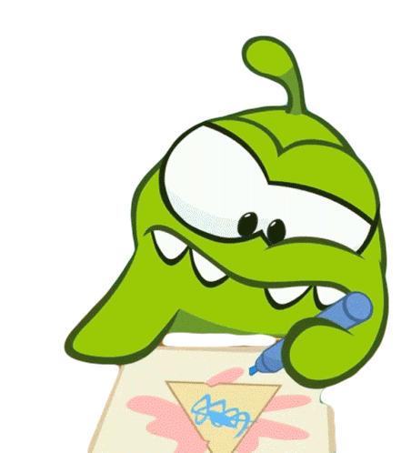

### Visual Asset Sources & Attribution
All visual assets were obtained from community preservation archives and curated specifically for this project:

- **Custom Pointer & Slice Effects:**
  Sourced from [The Spriters Resource – Cut the Rope (PC / Computer)](https://www.spriters-resource.com/pc_computer/cuttherope/). Used to extract the clean white pointer glove and configure the dynamic slice trail.
- **UI & Gameplay Components:**
  Sourced from [The Spriters Resource – Cut the Rope (Mobile)](https://www.spriters-resource.com/mobile/cutrope/asset/51423/). The archive provided the original master sprite sheets, from which only the necessary elements were extracted and preserved:
  - `btn_default_normal.png` & `btn_default_pressed.png`: Extracted from `menu_button_default_hd.png` at exact bounding coordinates `(4, 5, 459, 107)` and `(4, 116, 459, 218)` (455×102 px).
  - `menu_candy_swirl.png`: Extracted from `menu_logo_hd.png` with top rope attachment hole intact (164×163 px).
  - `omnom_idle.png` & `omnom_support.png`: Extracted cleanly from `char_animations_hd.png` and `char_support_01_hd.png`.
  - `apptivity_banner.png`: Cropped from `apptivity_image.png` featuring Om Nom with open mouth and falling candies.
  - `loaderbar_full.png` & `spinner.png`: Candy-striped progress bar and rotating wheel.
- **Promotional Illustrations & Showcase:**
  - `assets/docs/cut_the_rope_cover.png`: Original Cut the Rope cover illustration showcasing Om Nom, candy, and scissors.

- **Animated Community GIFs & Reactions (Tenor):**
  Character animation GIFs of Om Nom were sourced from [Tenor.com](https://tenor.com/) and adapted for documentation showcases and reactive visual feedback under non-commercial editorial sharing terms.

<details>
<summary><b>📋 Click to expand full Tenor GIF sources & credits (15 links)</b></summary>

<br>

| | Animation | Tenor Link | | Animation | Tenor Link |
| :---: | :--- | :--- | :---: | :--- | :--- |
| 👏 | Clapping | [Tenor](https://tenor.com/view/clapping-om-nom-om-nom-stories-excited-thrilled-gif-9984157943214291792) | 🤔 | Thinking | [Tenor](https://tenor.com/view/thinking-om-nom-cut-the-rope-considering-pondering-gif-26818523) |
| 🍬 | Feed Me | [Tenor](https://tenor.com/view/cut-the-rope-feedme-hungry-gif-11675089) | 🧠 | Brain Power | [Tenor](https://tenor.com/view/thinking-om-nom-om-nom-stories-using-all-my-brain-power-cut-the-rope-gif-10209083612735057102) |
| 😲 | Surprised | [Tenor](https://tenor.com/view/surprised-om-nom-om-nelle-cut-the-rope-omg-gif-1819623925838053034) | 🚶 | Marching | [Tenor](https://tenor.com/view/marching-om-nom-cut-the-rope-walking-exersicing-gif-14381300523123868607) |
| 😤 | Mad | [Tenor](https://tenor.com/view/mad-om-nom-om-nom-and-cut-the-rope-angry-annoyed-gif-24898606) | 🙅 | Shaking Head | [Tenor](https://tenor.com/view/shaking-my-head-om-nom-om-nom-and-cut-the-rope-smh-no-gif-25538657) |
| 😮 | Jaw Dropping | [Tenor](https://tenor.com/view/jaw-dropping-om-nom-nibble-nom-cut-the-rope-impressed-gif-8249317190795755440) | 😱 | Freaking Out | [Tenor](https://tenor.com/view/freaking-out-om-nom-cut-the-rope-screaming-going-crazy-gif-3927534681297224760) |
| 🎉 | Excited | [Tenor](https://tenor.com/view/excited-om-nom-om-nom-stories-om-nom-and-cut-the-rope-happy-gif-26647750) | 🤩 | Wow | [Tenor](https://tenor.com/view/wow-om-nom-cut-the-rope-that's-amazing-i-love-this-gif-12346611675352339536) |
| 🥊 | Ready to Fight | [Tenor](https://tenor.com/view/ready-to-fight-om-nom-om-nom-stories-fighting-stance-ready-to-brawl-gif-8029144922046973558) | 💋 | Kiss | [Tenor](https://tenor.com/view/kiss-on-the-cheek-om-nom-om-nom-stories-love-you-cut-the-rope-gif-17615010227572962049) |
| 😴 | Yawn *(Reserve)* | [Tenor](https://tenor.com/view/yawn-om-nom-cut-the-rope-bored-falling-asleep-gif-26818518) | | | |

</details>

- **Animated Controls & Interaction Icons:**
  - `assets/docs/controls_left_click.gif`, `assets/docs/controls_right_click.gif`, and `assets/docs/controls_cursor.gif`: Sourced from master vectors designed by **[Smashicons from Flaticon](https://www.flaticon.com/authors/smashicons)** under *Free for commercial use WITH ATTRIBUTION* license (Licensee: Angel Beltran, 19 Oct 2026). Rendered directly from vector paths with super-sampled antialiasing and procedural keyframe animations simulating tactile click bounce, dynamic velocity tilt, trailing particle ribbons, shockwave burst ripples, and blade swipe trail effects.

<br clear="right"/>

### Vector-Engineered Title Signboard

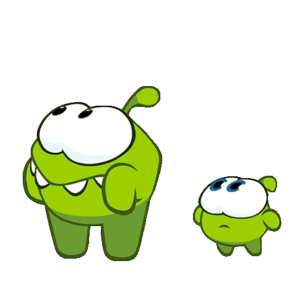

To prevent raster jaggedness and eliminate square background artifacts, the `"CUT THE ROPE"` title banner in the main menu is engineered directly as a vector Canvas element:
- Dual-line typography: `"CUT THE"` in warm cream with dark outline and `"ROPE"` in vibrant candy green with 3D drop shadow and top specular highlights.
- Beveled wooden board with brass corner rivets, suspended by two realistic ropes anchored to the ceiling.
- Vertically centered typography with balanced margins (~18 px top, ~17 px bottom) and safe clearance from the swinging pendulum candy.

<br clear="right"/>

### Intellectual Property & Trademark Protection
In strict adherence to intellectual property standards and educational use guidelines:
- All proprietary studio names, distributor brandings, and logos (*ZeptoLab*, *Chillingo*) were completely removed from all visual banners and interface components.
- The project is presented strictly as a non-commercial academic programming showcase.

---

## 🔊 Sound Design & Audio Adaptation

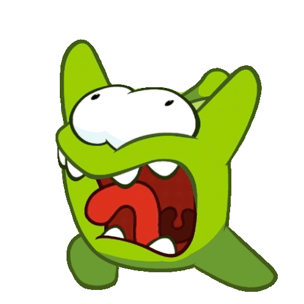

### Audio Sources & Attribution
The audio pipeline cleanly distinguishes between the ambient soundtrack and interactive gameplay sound effects:

- **Menu Theme Soundtrack:**
  Sourced from [Khinsider – Cut the Rope Arcade Gamerip (2016)](https://downloads.khinsider.com/game-soundtracks/album/cut-the-rope-arcade-gamerip-2016).
  - File: [`assets/06.-Menu-Music-Theme.wav`](assets/06.-Menu-Music-Theme.wav)
  - Format: Uncompressed 16-bit PCM WAV, 22,050 Hz Mono, 60.01 seconds seamless loop.

- **Interactive Gameplay Sound Effects (SFX):**
  All interactive sound effects—distinct from the background soundtrack—were sourced from [The Sounds Resource – Cut the Rope (Mobile) Asset #399589](https://sounds.spriters-resource.com/mobile/cutrope/asset/399589/):
  - **Rope Slicing:** [`assets/mechanics/slice.mp3`](assets/mechanics/slice.mp3) — Swish sound effect triggered when the swipe path cuts through a rope segment.
  - **Bubble Popping:** [`assets/mechanics/pop.mp3`](assets/mechanics/pop.mp3) — Crisp pop sound effect triggered upon bursting a buoyant bubble.
  - **Air Cushion Puff:** [`assets/mechanics/cushion.mp3`](assets/mechanics/cushion.mp3) — Directional compressed air pulse sound when tapping an air cushion / bellows.
  - **Star Collection Chimes:** [`assets/entities/star_1.wav`](assets/entities/star_1.wav), [`assets/entities/star_2.wav`](assets/entities/star_2.wav), [`assets/entities/star_3.wav`](assets/entities/star_3.wav) — Ascending melodic three-tier chime sequence as each consecutive star is collected.
  - **Om Nom Reactions:**
    - [`assets/entities/monster_open.wav`](assets/entities/monster_open.wav) — Anticipatory mouth opening sound when the candy approaches Om Nom.
    - [`assets/entities/monster_chewing.wav`](assets/entities/monster_chewing.wav) — Satisfied crunching and chewing sound upon successfully catching the candy.
    - [`assets/entities/monster_sad.wav`](assets/entities/monster_sad.wav) — Disappointed whimper/sigh when the candy is dropped out of bounds.

### Technical Audio Pipeline & Autoplay Compliance
Modern web browsers enforce strict security restrictions regarding audio playback:
1. **Autoplay Policy Unlock:**
   Browsers prevent audio playback before user interaction. [AudioManager.js](src/ui/AudioManager.js) establishes a passive interaction listener (`pointerdown`, `click`, `keydown`, `touchstart`) that immediately unlocks and triggers audio upon the player's first interaction.
2. **Smooth Audio Fade-Out:**
   When the player clicks "Start", the music does not cut abruptly. Instead, `fadeOutMenuMusic(500)` performs a linear volume attenuation over 500 ms before pausing.
3. **Page Visibility Synchronization:**
   An event listener on `visibilitychange` automatically pauses playback when the user switches browser tabs and resumes playback when returning.

<br clear="right"/>

---

## 📚 References & Research

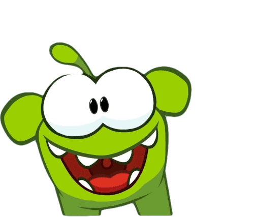

- **Visual Sprites (PC):** [The Spriters Resource – Cut the Rope (PC)](https://www.spriters-resource.com/pc_computer/cuttherope/)
- **Visual Sprites (Mobile Assets #51423):** [The Spriters Resource – Cut the Rope (Mobile)](https://www.spriters-resource.com/mobile/cutrope/asset/51423/)
- **Gameplay Sound Effects (SFX Mobile Asset #399589):** [The Sounds Resource – Cut the Rope (Mobile)](https://sounds.spriters-resource.com/mobile/cutrope/asset/399589/)
- **Controls & UI Vector Icons:** [Smashicons – Flaticon](https://www.flaticon.com/authors/smashicons) (Licensed under *Free License with Attribution*)
- **Original Soundtrack Archive:** [Khinsider – Cut the Rope Arcade Gamerip (2016)](https://downloads.khinsider.com/game-soundtracks/album/cut-the-rope-arcade-gamerip-2016)
- **Physics Engine Documentation:** [Matter.js Official Documentation & Constraint Guides](https://brm.io/matter-js/docs/)
- **Graphics Engine Documentation:** [p5.js Official Reference](https://p5js.org/reference/)
- **Community GIF & Reaction Archive:** [Tenor.com](https://tenor.com/) (Licensed via Tenor/Google Terms of Service for non-commercial editorial & showcase sharing)

<br clear="right"/>

---

## 🛠️ Technical Debt & Known Scope Limitations

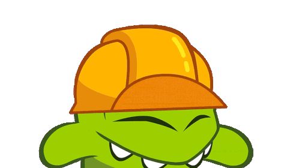

The following items represent architectural compromises, design differences, or features scheduled for subsequent development phases:

- **Single Background Soundtrack (Limited Audio Palette):**
  The game currently features only one of the multiple soundtracks available in the original release ([`assets/06.-Menu-Music-Theme.wav`](assets/06.-Menu-Music-Theme.wav)), looping continuously across states. It lacks the varied in-game world soundtracks (e.g., Cardboard Box, Fabric Box, Foil Box, Magic Box themes) as well as the commercial game's dynamic victory and defeat musical jingles.
- **Menu & UI Buttons with Text Labels (Non-Original Graphics):**
  The main menu and overlay action buttons use generic glossy pill capsules styled with programmatically rendered text labels via Canvas (`text('START')`, `text('NEXT')`, `text('RETRY')`, `text('MENU')`) rather than the bespoke, stylized typography and integrated iconography from the original game assets.
- **Absence of Level Persistence & Save History:**
  There is no level completion tracking or persistent storage mechanism (e.g., `localStorage` or cloud save). Progression is held strictly in volatile runtime memory (`LevelManager.currentLevel`). Reloading or closing the browser resets the player back to Level 1, and collected star scores are not retained across sessions.
- **Missing In-Game Navigation & Extra HUD Controls:**
  Inside active levels (`PLAYING` state), the HUD displays only the level number, collected stars, and an audio mute toggle. It does not include an in-game button to return to the main menu, a pause button, a hot-restart button, or any of the auxiliary buttons found in the original game (e.g., level select drawer, hint system, or shop shortcuts). If the candy gets stuck without falling out of bounds, players must trigger a loss or reload the page to restart.
- **Spiders & Dynamic Obstacles:**
  Spiders crawling up ropes to steal candy and hazards like electrical barriers or spikes were deferred to a future milestone.
- **Complex Multi-Candy Joints:**
  Dual-candy mechanics (connecting two treats simultaneously with elastic bands or combining halves) were simplified to single-candy physics for this sprint.
- **Level Selection World Map & Card-Packs:**
  The game currently transitions linearly from Level 1 to Level 4 via [LevelManager.js](src/entities/LevelManager.js) rather than presenting an interactive box selection map or star-gated level grid.

<br clear="right"/>

---

## 🚀 Running the Project Locally

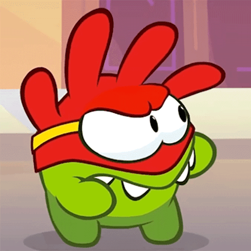

Thanks to the offline architecture implemented in [`src/ui/UIAssetData.js`](src/ui/UIAssetData.js) and the native HTML5 audio pipeline, **this project can be executed either directly as a local file or through an HTTP server**:

### Option 1: Direct File Execution (Zero Server Required)
Simply double-click [`index.html`](index.html) or open it directly in any modern browser:
```text
file:///path/to/CutTheRope/index.html
```

### Option 2: Local HTTP Server (Recommended for Development)
If you prefer running through a local development server:
- **VS Code:** Right-click [`index.html`](index.html) and select **"Open with Live Server"**.
- **Python:**
  ```bash
  python3 -m http.server 8000
  ```
  Open `http://localhost:8000` in your web browser.
- **Node.js:**
  ```bash
  npx serve .
  ```

<br clear="right"/>

---

## 🤖 Artificial Intelligence Disclosure & Acknowledgments

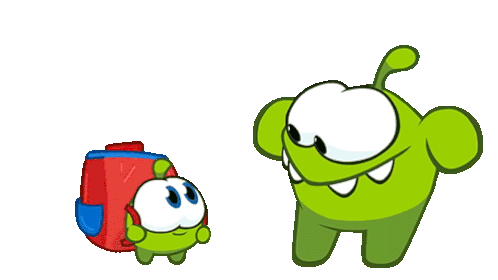

Artificial Intelligence tools (**Google Antigravity / Gemini**) were utilized as pair-programming assistants throughout the development of this project. AI assistance was utilized for:
- **Architecture & System Contracts:** Defining clean modular boundaries between physics simulation ([PhysicsWorld.js](src/core/PhysicsWorld.js)), UI rendering ([UIManager.js](src/ui/UIManager.js)), and state transitions ([GameState.js](src/ui/GameState.js)).
- **Coordinate Analysis & Sprite Slicing:** Calculating exact bounding boxes and resolving aspect ratio distortions on button and candy sprites.
- **Browser Compatibility Engineering:** Diagnosing Chromium CORS constraints on local `file:///` protocols and engineering the in-memory Base64 fallback system ([UIAssetData.js](src/ui/UIAssetData.js)) and HTML5 audio unlockers.
- **Documentation & Structuring:** Drafting and formatting this comprehensive `README.md`.

<br clear="right"/>